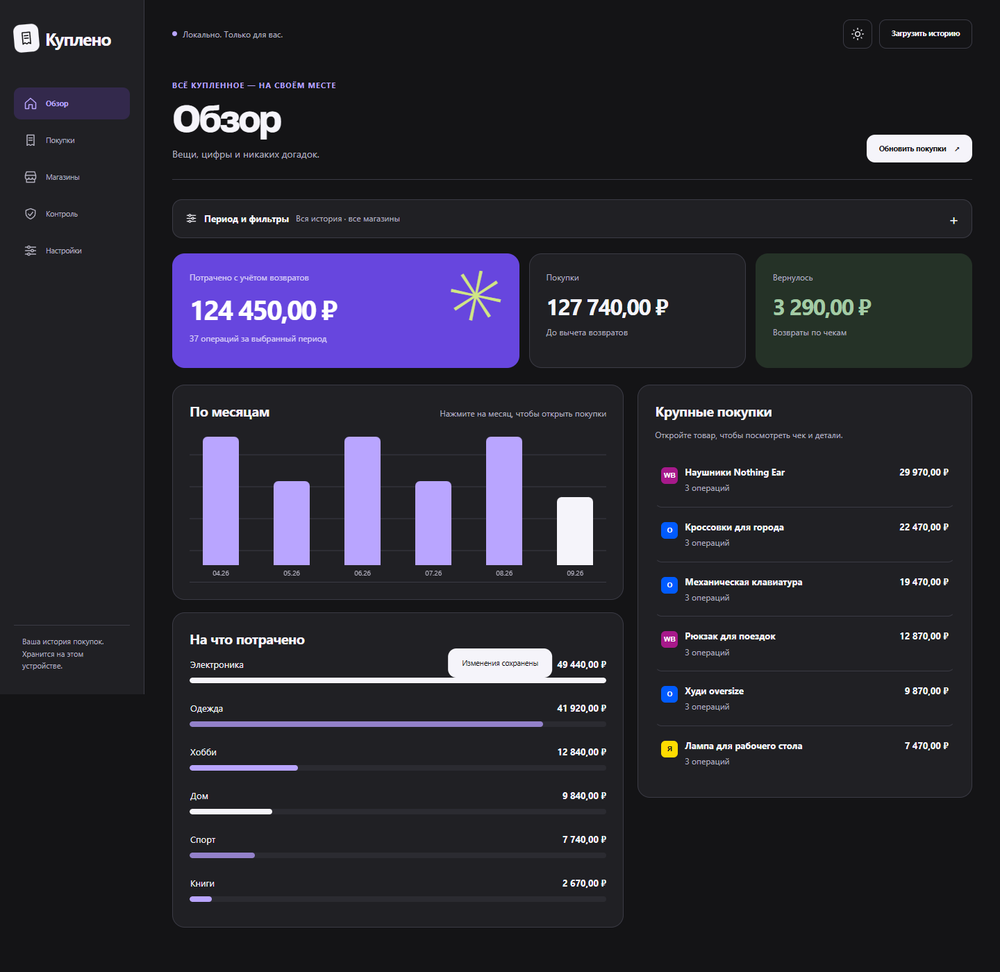
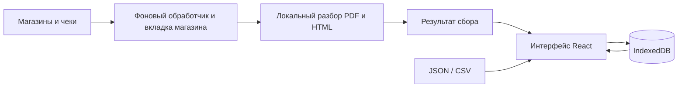

# Куплено

Личный журнал покупок с Ozon, Wildberries и Яндекс Маркета. Чтобы видеть расходы, находить нужную вещь и не терять возвраты и чеки. Данные хранятся в браузере; сервер продукта и аккаунт в «Куплено» не нужны. [Как устроено хранение](docs/PREVIEW.md#данные).

**Сейчас развиваем предпросмотр 0.21.0.** Интерфейс, импорт, правки и восстановление проверены в отдельном браузере. Живой сбор на аккаунтах магазинов ещё не подтверждён полностью: у Ozon были ошибки загрузки PDF, у Яндекса - повтор страницы и недоступные чеки. Деморолик не доказывает исправность этих интеграций. [Проверки и ограничения](docs/PREVIEW.md#проверки-и-пробелы).

[Демо с озвучкой, 57 секунд](assets/demo/kupleno-0.21-voice.mp4) · [План для ревью](PLAN.md) · [Новому агенту](AGENTS.md) · [Устройство кода](docs/PREVIEW.md)



## Попробовать

Нужны Node.js 24 и npm. Из корня репозитория:

```sh
npm ci
npm --prefix extension/next ci
npm run preview:check
```

В Chrome/Edge откройте `chrome://extensions`, включите режим разработчика, нажмите «Загрузить распакованное расширение» и выберите `extension/next/.output/chrome-mv3`. Откройте «Куплено - новая версия». Можно загрузить JSON/CSV или перейти в «Магазины». Для живого сбора нужен вход в магазин в этом же браузере и разрешение расширению на выбранный сайт. [Команды и зависимости](docs/PREVIEW.md#запуск).

При обновлении используйте ту же папку расширения, чтобы сохранить ID и доступ к локальной базе. Сначала экспортируйте резервную копию. Не удаляйте старое расширение ради проверки нового. [Миграция](docs/PREVIEW.md#данные).

## Что внутри



Обработчик получает документы, парсеры извлекают операции. Интерфейс сохраняет результат в IndexedDB и только потом подтверждает сбор. Категории и поиск возможных повторов работают по локальным правилам, без языковой модели. [Точки входа и путь данных](docs/PREVIEW.md#путь-данных).

Есть обзор расходов, поиск покупок, заметки, категории, профили, массовые правки, бюджет, ожидания возвратов и гарантии. Возможные повторы требуют проверки: одинаковая цена сама по себе не делает покупку дублем. [Код экранов](extension/next/ui/App.tsx), [проверки покупок](extension/next/intelligence.ts).

## Две версии в одном репозитории

- `extension/next` - новый предпросмотр [0.21.0](extension/next/package.json). Его проверяют команды `preview:*`.
- `extension` без `next` - предыдущая реализация. Текущая версия исходников: `0.19.2`. Её версия хранится в [manifest](extension/manifest.json), а команды `verify:*` и старый выпуск ZIP относятся именно к ней. [Старая документация](docs/README.md).

Не собирайте новый продукт старым упаковщиком: он намеренно берёт только файлы прежней версии. Публикация кода предпросмотра не означает новый стабильный Release или выпуск в магазине расширений.

## Работа вдвоём

Перед задачей обновите ветки, посмотрите открытые PR/issues, зафиксируйте владельца и границы файлов. Небольшие проверенные изменения коммитьте и отправляйте в отдельную рабочую ветку. Не переписывайте чужую историю. Полные правила - в [AGENTS.md](AGENTS.md).

[Как записать демо и озвучку](docs/DEMO.md). В опубликованном ролике только вымышленные покупки; личные копии базы не входят в репозиторий.

Сохраняется существующая [лицензия MIT](LICENSE); лицензии зависимостей перечислены в [THIRD_PARTY_NOTICES.md](THIRD_PARTY_NOTICES.md) и [файлах предпросмотра](extension/next/public/licenses/).
