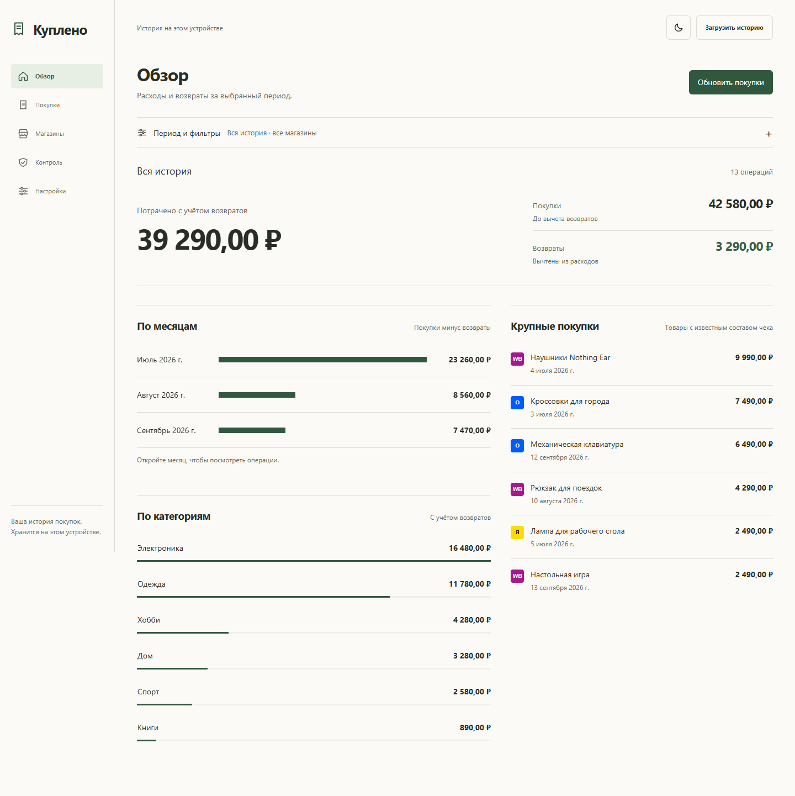
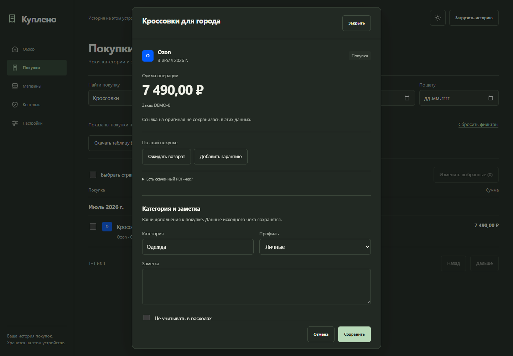
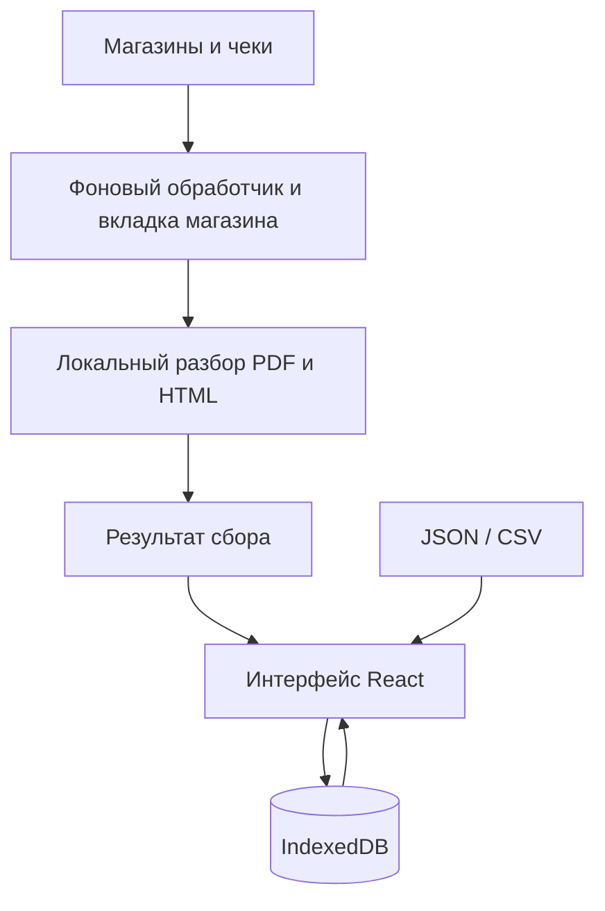

# Куплено

Локальный журнал покупок, возвратов и чеков Ozon, Wildberries и Яндекс Маркета.

<p>  </p>

**[Демо](assets/demo/kupleno-0.21-voice.mp4) · [Запуск](#запуск) · [Архитектура](#архитектура) · [План](PLAN.md) · [Для агента](AGENTS.md)**

## Как выглядит


*Обзор: расходы с учётом возвратов, месяцы и крупные покупки.*

<details>
<summary>Ещё два экрана: светлая тема и карточка покупки</summary>



*Тот же обзор в светлой теме. Фильтры раскрываются на месте.*



*Карточка вещи: заметка, категория, гарантия и ожидание возврата. На всех экранах вымышленные данные из [сценария](scripts/next-design-demo.cjs).*

</details>

## Что работает

Есть обзор расходов, поиск покупок, заметки, категории, профили, массовые правки, бюджет, ожидания возвратов и гарантии. Возможные повторы требуют проверки: одинаковая цена сама по себе не делает покупку дублем. [Код экранов](extension/next/ui/App.tsx), [проверки покупок](extension/next/intelligence.ts).

Импорт JSON/CSV, редактирование и восстановление проверяются в отдельном Chromium. История хранится в браузере; сервер продукта и аккаунт в «Куплено» не нужны. [Хранение](docs/PREVIEW.md#данные).

## Запуск

Нужны Node.js 24 и npm. Из корня репозитория:

```sh
npm ci
npm --prefix extension/next ci
npx playwright install chromium
npm run preview:check
```

В Chrome/Edge откройте `chrome://extensions`, включите режим разработчика, нажмите «Загрузить распакованное расширение» и выберите `extension/next/.output/chrome-mv3`. Откройте «Куплено - новая версия». Можно загрузить JSON/CSV или перейти в «Магазины». Для живого сбора нужен вход в магазин в этом же браузере и разрешение расширению на выбранный сайт. [Команды и зависимости](docs/PREVIEW.md#запуск).

При обновлении используйте ту же папку расширения, чтобы сохранить ID и доступ к локальной базе. Сначала экспортируйте резервную копию. Не удаляйте старое расширение ради проверки нового. [Миграция](docs/PREVIEW.md#данные).

## Архитектура



Обработчик получает документы, парсеры извлекают операции. Интерфейс сохраняет результат в IndexedDB и только потом подтверждает сбор. Категории и поиск возможных повторов работают по локальным правилам, без языковой модели. [Точки входа и путь данных](docs/PREVIEW.md#путь-данных).

## Статус и ограничения

Основная ветка `main` содержит новый предпросмотр **0.21.0**. Старый опубликованный код сохранён тегом [archive/pre-021-20261004](https://github.com/malyarq/kupleno/tree/archive/pre-021-20261004). [Точный откат](docs/PREVIEW.md#откат-основной-ветки).

- `extension/next` - новый предпросмотр [0.21.0](extension/next/package.json). Его проверяют команды `preview:*`.
- `extension` без `next` - архивная реализация. Текущая версия исходников: `0.19.2` (только архив). Её версия хранится в [manifest](extension/manifest.json), а команды `verify:*` и старый выпуск ZIP относятся именно к ней. [Архивная документация](docs/README.md).

Не собирайте новый продукт старым упаковщиком: он намеренно берёт только файлы прежней версии. Публикация кода предпросмотра не означает новый стабильный Release или выпуск в магазине расширений.

Живой сбор Ozon после смены транспорта PDF и полнота Яндекса ещё требуют проверки. Демонстрация использует вымышленные покупки и не подтверждает работу с аккаунтами магазинов. Категории и кандидаты на повторы определяются локальными правилами, без LLM или OCR-сервиса. [Оставшиеся задачи](PLAN.md), [границы проверок](docs/PREVIEW.md#проверки-и-пробелы).

## Разработка

Перед задачей обновите ветки, посмотрите открытые PR/issues, зафиксируйте владельца и границы файлов. Небольшие проверенные изменения коммитьте и отправляйте в отдельную рабочую ветку. Не переписывайте чужую историю. Полные правила - в [AGENTS.md](AGENTS.md).

[Проверки CI](https://github.com/malyarq/kupleno/actions/workflows/preview.yml) доступны участникам репозитория. Команды и охват - в [документации проверок](docs/PREVIEW.md#проверки-и-пробелы).

[Как записать демо и озвучку](docs/DEMO.md). В опубликованном ролике только вымышленные покупки; личные копии базы не входят в репозиторий.

Сохраняется существующая [лицензия MIT](LICENSE); лицензии зависимостей перечислены в [THIRD_PARTY_NOTICES.md](THIRD_PARTY_NOTICES.md) и [файлах предпросмотра](extension/next/public/licenses/).
