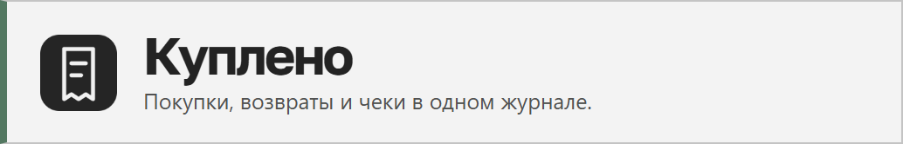

 

**[Скачать Куплено 0.22.15](https://github.com/376east/kupleno/releases/download/v0.22.15-preview.1/kupleno-extension.zip)** · [Инструкция по установке](docs/PREVIEW.md#запуск)

Покупки, возвраты и чеки Ozon, Wildberries и Яндекс Маркета в одном журнале. Данные хранятся в браузере.

## Установка

Распакуйте ZIP и загрузите папку расширения в режиме разработчика Chrome или Edge. Для сбора истории войдите в магазин в том же браузере. Для знакомства с журналом можно импортировать JSON или CSV.

Перед обновлением экспортируйте резервную копию. Сохраняйте установленную папку расширения, чтобы сохранить доступ к локальной базе. [Резервные копии и данные](docs/PREVIEW.md#данные)

## Ссылки проекта

[История изменений](CHANGELOG.md) · [Поддержка](SUPPORT.md) · [MIT](LICENSE) · [Сторонние компоненты](THIRD_PARTY_NOTICES.md)
