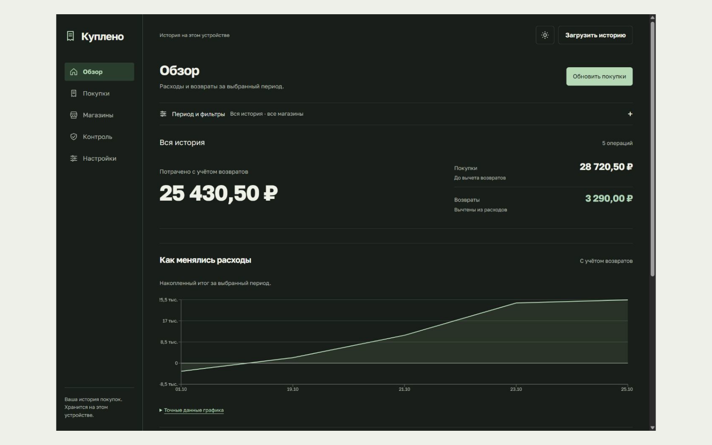
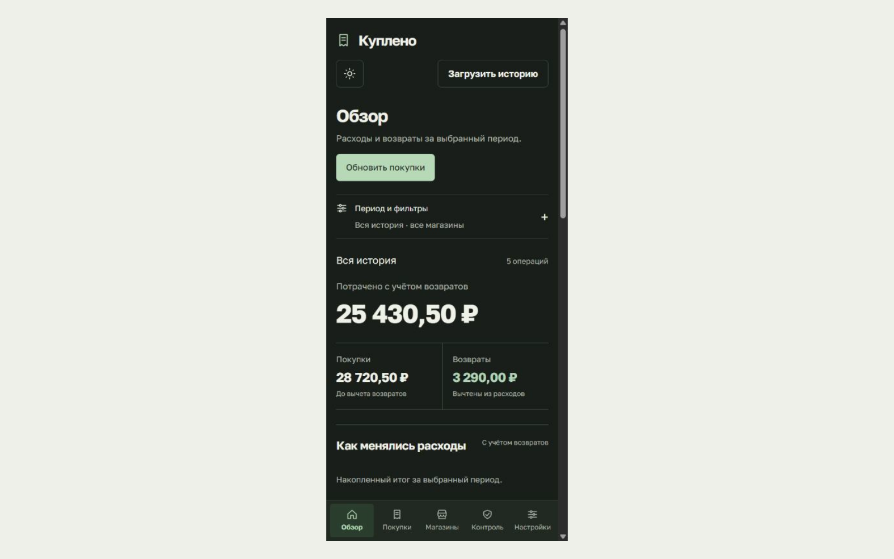
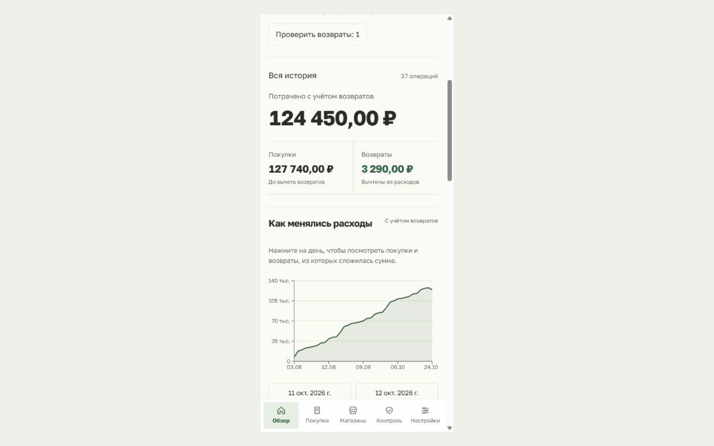
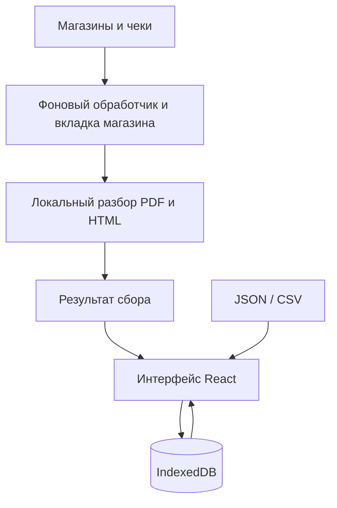

# Куплено

Локальный журнал покупок, возвратов и чеков Ozon, Wildberries и Яндекс Маркета.

<p><a href="#статус-и-ограничения"></a> <a href="https://github.com/malyarq/kupleno/actions/workflows/ci.yml"></a> <a href="extension/next/package.json"></a> <a href="docs/assets/readme/current-flow.mp4"></a></p>

**[Скриншоты](#как-выглядит) · [Возможности](#что-работает) · [Запуск](#запуск) · [Архитектура](#архитектура) · [Ограничения](#статус-и-ограничения) · [Разработка](#разработка)**

## Как выглядит

<a href="docs/assets/readme/overview.svg"></a>

Обзор выделяет покупки, возвраты и операции, которым нужно внимание. Из графика можно перейти к журналу выбранного дня, сохраняя фильтры. На снимках вымышленные операции в отдельной IndexedDB; живые аккаунты магазинов не использовались. [Источник снимков](docs/assets/readme/prototype-transfer.json).

**[Актуальное демо MP4](docs/assets/readme/current-flow.mp4)** · 00:29 · 26 октября 2026 · [Источник записи](docs/assets/readme/current-flow.json)

[Предыдущее демо, 00:43](assets/demo/kupleno-demo.mp4) · [Материалы демо](docs/DEMO.md)

<details>
<summary>Ещё два экрана</summary>

**Операции выбранного дня.**

<a href="docs/assets/readme/screen-2.svg"></a>

**График расходов на телефоне.**

<a href="docs/assets/readme/screen-3.svg"></a>

</details>

## Что работает

- **Основное:** просматривать расходы и покупки, искать нужное, вести заметки и категории. [Код экранов](extension/next/ui/App.tsx).
- **Дополнительно:** профили, массовые правки, бюджет, ожидания возвратов и гарантии; импорт JSON/CSV, редактирование и восстановление. [Возможности и проверки](docs/PREVIEW.md).
- **Данные:** история хранится в браузере; сервер продукта и аккаунт в «Куплено» не нужны. Кандидатов на повторы нужно проверять: одинаковая цена не делает покупку дублем. [Хранение](docs/PREVIEW.md#данные), [правила](extension/next/intelligence.ts).

## Запуск

### Требования

Нужны Node.js 24 и npm. Из корня репозитория:

### Быстрый старт

```powershell
git clone https://github.com/malyarq/kupleno.git
cd kupleno
npm ci
npm --prefix extension/next ci
npx playwright install chromium
npm run preview:check
```

### Данные и доступ

В Chrome/Edge откройте `chrome://extensions`, включите режим разработчика, нажмите «Загрузить распакованное расширение» и выберите `extension/next/.output/chrome-mv3`. Откройте «Куплено - новая версия». Можно загрузить JSON/CSV или перейти в «Магазины». Для живого сбора нужен вход в магазин в этом же браузере и разрешение расширению на выбранный сайт. [Команды и зависимости](docs/PREVIEW.md#запуск).

При обновлении используйте ту же папку расширения, чтобы сохранить ID и доступ к локальной базе. Сначала экспортируйте резервную копию. Не удаляйте старое расширение ради проверки нового. [Миграция](docs/PREVIEW.md#данные).

## Архитектура



Обработчик получает документы, парсеры извлекают операции. Интерфейс сохраняет результат в IndexedDB и только потом подтверждает сбор. Категории и поиск возможных повторов работают по локальным правилам, без языковой модели. [Точки входа и путь данных](docs/PREVIEW.md#путь-данных).

## Статус и ограничения

| Параметр | Состояние |
| --- | --- |
| Стадия | В разработке. [План](PLAN.md). |
| Версия | 0.22.6, preview. [extension/next/package.json](extension/next/package.json). |
| Лицензия | MIT. [LICENSE](LICENSE). |

### Ограничения

Основная ветка `main` содержит новый предпросмотр **0.22.6**. Старый опубликованный код сохранён тегом [archive/pre-021-20261004](https://github.com/malyarq/kupleno/tree/archive/pre-021-20261004). [Точный откат](docs/PREVIEW.md#откат-основной-ветки).

- `extension/next` - новый предпросмотр [0.22.6](extension/next/package.json). Его проверяют команды `preview:*`.
- `extension` без `next` - архивная реализация. Текущая версия исходников: `0.19.2` (только архив). Её версия хранится в [manifest](extension/manifest.json), а команды `verify:*` и старый выпуск ZIP относятся именно к ней. [Архивная документация](docs/README.md#архив-0192).

Не собирайте новый продукт старым упаковщиком: он намеренно берёт только файлы прежней версии. Публикация кода предпросмотра не означает новый стабильный Release или выпуск в магазине расширений.

Живой сбор Ozon после смены транспорта PDF и полнота Яндекса ещё требуют проверки. Демонстрация использует вымышленные покупки и не подтверждает работу с аккаунтами магазинов. Категории и кандидаты на повторы определяются локальными правилами, без LLM или OCR-сервиса. [Оставшиеся задачи](PLAN.md), [границы проверок](docs/PREVIEW.md#проверки-и-пробелы).

## Разработка

[Документация](docs/PREVIEW.md) · [План](PLAN.md) · [Правила](AGENTS.md) · [CI](https://github.com/malyarq/kupleno/actions/workflows/ci.yml)

<details>
<summary>Проверки и работа над проектом</summary>

Перед задачей обновите ветки, посмотрите открытые PR/issues, зафиксируйте владельца и границы файлов. Небольшие проверенные изменения коммитьте и отправляйте в отдельную рабочую ветку. Не переписывайте чужую историю. Полные правила - в [AGENTS.md](AGENTS.md).

[Проверки CI](https://github.com/malyarq/kupleno/actions/workflows/ci.yml) доступны участникам репозитория. Команды и охват - в [документации проверок](docs/PREVIEW.md#проверки-и-пробелы).

[Как записать демо и озвучку](docs/DEMO.md). В опубликованном ролике только вымышленные покупки; личные копии базы не входят в репозиторий.

Сохраняется существующая [лицензия MIT](LICENSE); лицензии зависимостей перечислены в [THIRD_PARTY_NOTICES.md](THIRD_PARTY_NOTICES.md) и [файлах предпросмотра](extension/next/public/licenses/).

</details>
